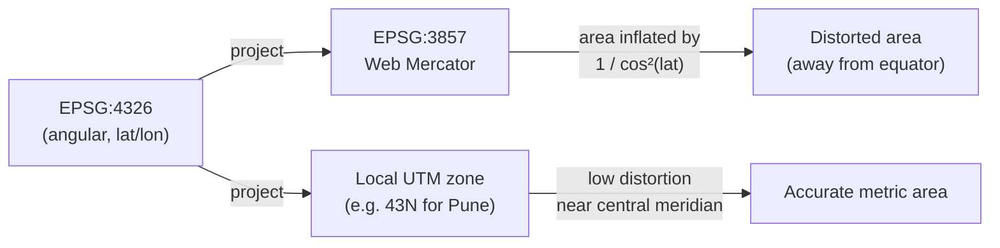

# S1 — OGC services and CRS

## WMS 1.1.1 vs 1.3.0, and the EPSG:4326 axis-order change

WMS (Web Map Service) returns a rendered image (PNG/JPEG) of a map for a
requested bounding box. The request shape is nearly identical across
versions, but **1.3.0 changed how coordinate axis order is interpreted**
for a geographic CRS:

- In **1.1.1**, `BBOX` is always `minx,miny,maxx,maxy` — i.e.
  `longitude,latitude,longitude,latitude` for EPSG:4326 — regardless of
  what the CRS definition itself says.
- In **1.3.0**, the OGC standard says a CRS's *own authority-defined axis
  order* applies. EPSG:4326 is officially defined as
  **latitude, longitude**, so a 1.3.0 `BBOX` for EPSG:4326 must be given
  as `miny,minx,maxy,maxx` — the two coordinates of each pair are swapped
  relative to 1.1.1.

Sending the *same four numbers* to both versions therefore does not
request the same area: one interprets them as (lon,lat) pairs, the other
as (lat,lon) pairs. This is the single most common practical bug when
migrating WMS clients between versions, and is exactly what Q4 asks to
demonstrate.

## WFS 2.0 with filters

WFS (Web Feature Service) returns actual feature data (geometry +
attributes), not a rendered image — `GetFeature` with an OGC filter (e.g.
`PropertyIsNotEqualTo` for "has a name tag") lets a client ask for a
specific subset of features server-side, instead of downloading
everything and filtering client-side. WFS 2.0 added standard
pagination (`count`, `startIndex`) and reports `numberMatched` /
`numberReturned` so a client knows whether it received a full or partial
result.

## What WCS and OGC API – Features add

- **WCS** (Web Coverage Service) is WMS's counterpart for *raster*
  coverages (e.g. a DEM): instead of a pre-rendered image, it returns the
  actual underlying grid data (e.g. as GeoTIFF), so a client can run its
  own analysis on the raw values rather than just display a picture of them.
- **OGC API – Features** is the modern, REST/JSON redesign of WFS's job:
  plain HTTP GET requests with query parameters, JSON (GeoJSON) responses
  by default, and an auto-discoverable API description — built to be
  consumed the way any other web API is, without needing an XML/SOAP-style
  client.

## EPSG:4326 vs 3857 vs UTM, and why area depends on the CRS

- **EPSG:4326** (WGS84 lat/lon) is an *angular* coordinate system —
  degrees, not a uniform linear unit. Computing area directly on raw
  4326 coordinates (`ST_Area` on the plain geometry) gives a number in
  square *degrees*, which has no direct real-world meaning and
  **distorts area differently depending on latitude** (a degree of
  longitude covers less real ground the further you are from the
  equator).
- **EPSG:3857** (Web Mercator) is a *projected, conformal* CRS used for
  web-map tiling, but Mercator **inflates area away from the equator** —
  the inflation factor is `1 / cos²(latitude)`, which is why a 3857 area
  measurement needs correcting if it's meant to represent real ground
  area.
- A **UTM zone** is also projected, but it's chosen so that the zone's
  central meridian passes through (or very near) the area being measured,
  keeping linear/area distortion minimal in that specific zone — which is
  exactly why "metric work" (buffers, distances, areas) should use the
  local UTM zone, not 3857 or raw 4326.

