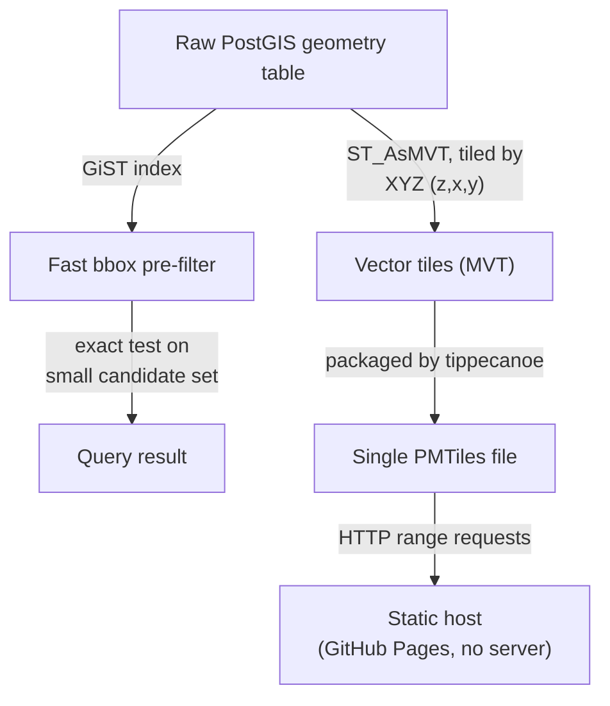

# S2 — Tiles and indexes

## XYZ tile scheme and zoom levels

Web maps split the world into a pyramid of square tiles. At zoom level
`z`, the world is divided into `2^z × 2^z` tiles, each identified by
`(z, x, y)` — `x` counting tile columns from the west edge, `y` counting
tile rows from the north edge (the "XYZ"/"Slippy map" convention). Zoom 0
is the whole world in one tile; each zoom level doubles resolution in
both directions, so tile count (and total data) grows by 4× per level.
A client only ever requests the handful of tiles covering its current
viewport at its current zoom, which is what makes panning/zooming a huge
area feel instant instead of loading the whole dataset.

## Raster vs vector tiles (MVT, PMTiles)

- A **raster tile** is a pre-rendered image (PNG/JPEG) — fixed styling,
  cheap for the client to draw, but every style change means
  re-rendering and re-serving every tile at every zoom.
- A **vector tile** (MVT — Mapbox Vector Tile, a compact binary/Protobuf
  format) instead ships the raw geometry + attributes for that tile's
  area. The *client* renders it, so styling (colors, which layers are
  visible, label text) can change instantly with no server round-trip,
  and the same tile data can be restyled for light/dark themes, data-driven
  colors, etc.
- **PMTiles** is a single-file container format for a whole set of vector
  (or raster) tiles, indexed so that a client can fetch just the bytes for
  one tile using an HTTP **range request** — meaning a static file host
  with no tile server at all (e.g. GitHub Pages) can serve tiles directly,
  which is exactly what Phase 5's serverless deployment relies on.

## GiST indexes and the bounding-box pre-filter

A **GiST index** (Generalized Search Tree) is what PostGIS uses to index
geometry columns. Spatial predicates like `ST_DWithin`, `ST_Intersects`,
or `<->` (distance) are expensive to evaluate exactly on every single row,
so PostgreSQL's query planner first uses the GiST index to cheaply find
every row whose **bounding box** might satisfy the predicate (a fast,
approximate pre-filter), and only runs the exact, expensive geometric
test on that much smaller candidate set. Without the index, the planner
falls back to a sequential scan — evaluating the exact predicate against
*every* row — which is why adding a GiST index typically turns an
`O(n)` scan into something close to `O(log n)` for a spatial lookup
(this is exactly what Q2 asks to measure with `EXPLAIN ANALYZE`).

## H3 hexagons and resolutions

H3 is a global hexagonal grid system: the earth's surface is tiled with
hexagonal cells at 16 **resolutions** (0 = coarsest, continent-scale; 15 =
finest, sub-metre). Each cell has a unique 64-bit index, and cells at one
resolution subdivide cleanly into ~7 child cells at the next resolution.
Hexagons are preferred over square grids for spatial analysis because
every hexagon's neighbors are all equidistant from its center (a square
grid's diagonal neighbors are farther away than its edge neighbors),
which makes hexagon-based distance/adjacency calculations more uniform —
useful here for aggregating "distance to nearest service" per cell
without that distortion.

