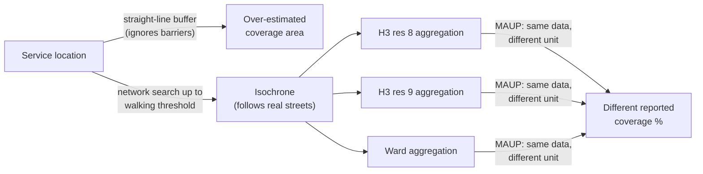

# S3 — Measuring access

## Network distance vs straight-line distance

A straight-line ("as the crow flies") buffer around a service assumes a
person can walk directly toward it in any direction. Real walking is
constrained to the street/path network, so the actual walkable distance
is almost always **longer** than the straight-line distance — sometimes
dramatically so, when a river, railway, highway, or gated campus forces a
long detour around a barrier that a straight line would simply cross.
A straight-line buffer therefore systematically **over-estimates** how
much area/population is actually within reach, which is precisely the
gap Q6 is designed to surface by comparing the two directly on the same
points.

## Isochrones

An isochrone ("equal time") is the actual reachable area from a point
within a given travel time — built here by running a shortest-path
search outward from the service location across the walking network up
to the time/distance budget (the threshold), then taking the boundary
(hull) of every street segment/node actually reached. Unlike a buffer,
an isochrone's shape follows the real street layout, so it can be
narrow and winding near barriers and wide and round in open grid-like
areas — which is exactly why a hull-shape choice (convex vs concave vs
buffered-edges) matters: a convex hull in particular can claim coverage
over large gaps the network never actually reaches.

## Walking-speed assumptions

Converting a time threshold into a distance budget requires an assumed
walking speed — this project uses 4.8 km/h (a typical average adult
pace) to turn "15 minutes" into "1.2 km." That assumption is not neutral:
a slower assumed speed (e.g. 3.6 km/h, more typical for elderly walkers)
shrinks the reachable distance for the *same* time budget, which can flip
whether a given resident counts as "covered" or not — this is exactly
what Q8 asks to quantify.

## The Modifiable Areal Unit Problem (MAUP)

MAUP is the well-known statistical effect where **the same underlying
data can produce different-looking conclusions depending on how it is
aggregated into spatial units** — both the size (scale effect) and the
boundary placement (zoning effect) of the units matter. Concretely here:
computing "% of population beyond the walking threshold" aggregated by
*ward* vs by *H3 resolution 8* vs by *H3 resolution 9* can each report a
different coverage percentage for the exact same underlying
point-by-point network-distance results, purely because of where the
aggregation-unit boundaries happen to fall relative to where the
under-served residents actually are. This is why Q7 asks for the same
coverage figure computed multiple ways — the differences *are* the
answer, not noise to average away.

