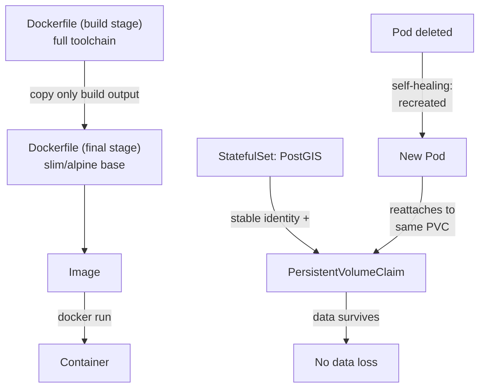

# S4 — Docker and Kubernetes

## Image vs container

A Docker **image** is a read-only, layered filesystem snapshot plus
metadata (entrypoint, exposed ports, env defaults) — it's the "recipe,"
never running by itself. A **container** is a running (or stopped)
*instance* of an image: the image's layers plus one thin writable layer
on top for anything the running process changes. Many containers can be
started from the same image, each getting its own writable layer and
process space, without duplicating the shared read-only image data.

## Dockerfile layers and multi-stage builds

Each instruction in a Dockerfile (`RUN`, `COPY`, etc.) creates a new
filesystem layer, cached by content — if an earlier layer hasn't
changed, Docker reuses it instead of rebuilding, which is why
Dockerfiles conventionally copy dependency manifests and install
dependencies *before* copying application source: source code changes
far more often than dependencies, so that ordering maximizes cache hits.
A **multi-stage build** uses more than one `FROM` in one Dockerfile — an
early stage can have a full toolchain (compilers, build tooling) to
produce build output, and a later, final stage copies *only* that output
onto a minimal base image (e.g. `nginx:alpine`). The build tools
themselves never end up in the shipped image, which is why multi-stage
images are typically far smaller than single-stage ones built from a
full base image (the comparison Q10 asks for).

## Compose vs Kubernetes building blocks

Docker Compose describes a fixed set of containers and how they network
together on one host — good for local development, as used for this
project's PostGIS + GeoServer + pg_tileserv + pg_featureserv stack.
Kubernetes is the equivalent for a *cluster* of machines, with more
specific building blocks:
- **Pod** — the smallest deployable unit; one or more tightly-coupled
  containers that always run together on the same node.
- **Deployment** — manages a set of identical, *stateless* Pods, handling
  rolling updates and restarting failed Pods; the right abstraction for
  something interchangeable, like this project's map client.
- **StatefulSet** — like a Deployment, but for Pods that are **not**
  interchangeable (each gets a stable identity and its own persistent
  storage) — the right abstraction for a database like PostGIS, since
  losing or shuffling its data would not be acceptable.
- **Service** — a stable network address/DNS name in front of a changing
  set of Pods, so other Pods (or `kubectl port-forward`) can reach "the
  database" without caring which specific Pod instance is currently
  running it.
- **Secret** — small pieces of sensitive config (e.g. a database
  password) stored separately from the Pod spec and mounted in at
  runtime, rather than baked into an image or a plain manifest file.
- **PersistentVolumeClaim (PVC)** — a request for storage that outlives
  any single Pod; a StatefulSet's PVC keeps existing even if its Pod is
  deleted and recreated, which is what lets the new Pod pick up the same
  data again.

## Self-healing, and why a database needs persistent storage

Kubernetes continuously compares the cluster's actual state to the
*desired* state declared in a Deployment/StatefulSet, and automatically
recreates any Pod that disappears or fails its health check — this is
"self-healing." For a stateless Deployment, a recreated Pod starting
with empty local storage is fine, since nothing in it was unique. For a
database, that would mean **losing all data on every restart** unless
its storage is a PersistentVolumeClaim — storage that lives outside the
Pod's own lifecycle, so a freshly recreated Pod reattaches to the same
PVC and picks up right where its predecessor left off. This is exactly
why a database is modeled as a StatefulSet with a PVC rather than a
plain Deployment with ephemeral storage (Q11 asks to demonstrate this
directly, including what's lost if the PVC is swapped for `emptyDir`,
which is explicitly *not* persistent).

